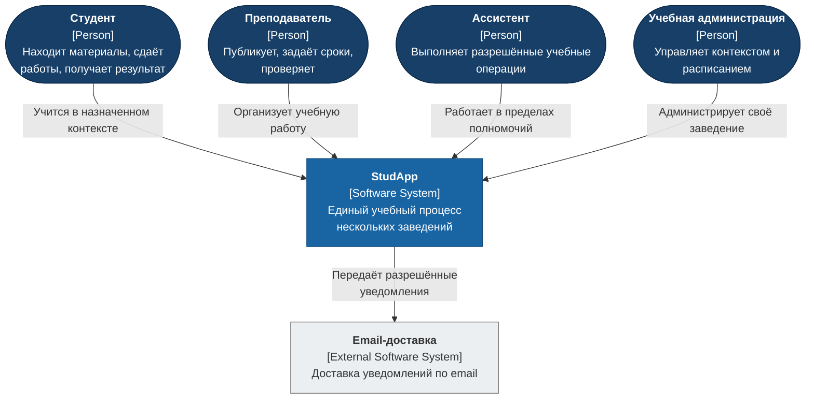
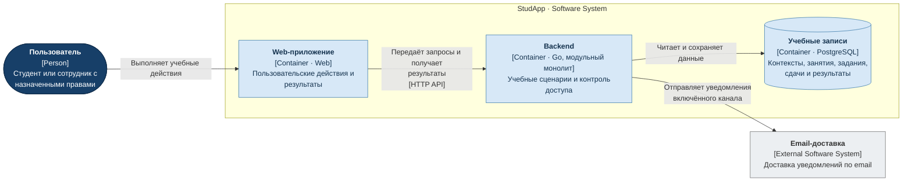

# Пользовательские сервисы StudApp

Описана целевая архитектура пользовательских возможностей: границы ответственности, данные, взаимодействия и логика экранов.

Состав MVP — согласно [PRD][prd] и [OnePager][onepager], бизнес-правила — согласно [SRS][srs] и [User Stories][us], приёмочные проверки — согласно [RTM][rtm].

## Стек backend

- **Go** — backend; **PostgreSQL** — база данных.
- **chi** — HTTP-маршруты и middleware.
- **golang-migrate** — SQL-миграции `.up.sql` / `.down.sql`.
- **log/slog** — структурированные логи.
- **Docker + Docker Compose** — локальный запуск.
- **testing + httptest** — тесты; PostgreSQL — интеграционные проверки.
- **OpenAPI** — спецификация API в `api/`.

## Модульный монолит

Backend запускается как одно приложение на Go. Каждый сервис ниже задаёт границу бизнес-логики: владеет своими данными, правилами и прикладными операциями и предоставляет контракты другим сервисам.

## Каталог сервисов

| Сервис | Задачи пользователя | Связанные сервисы |
|---|---|---|
| `account` — [Кабинет и учебный контекст](services/account.md) | Вход, выбор заведения, доступные возможности, выход | `administration` |
| `schedule` — [Расписание](services/schedule.md) | Неделя, занятие, связанные материалы и задания; управление занятиями | `administration`, `materials`, `assignments`, `notifications` |
| `materials` — [Учебные материалы](services/materials.md) | Открытие материала; подготовка и публикация | `administration`, `schedule` |
| `assignments` — [Задания и дедлайны](services/assignments-deadlines.md) | Условие задания, публикация, сроки, состав команд | `administration`, `submissions`, `notifications` |
| `submissions` — [Сдача работ](services/submissions.md) | Подготовка и сдача ответа, замена и отзыв, командная работа | `administration`, `assignments`, `review` |
| `review` — [Проверка работ](services/review.md) | Проверка ответа, оценка и комментарий, возврат на доработку | `administration`, `submissions`, `results`, `notifications` |
| `results` — [Результаты и приватность](services/results.md) | Опубликованные оценки, итог дисциплины, видимость данных | `administration`, `review` |
| `notifications` — [Уведомления и напоминания](services/notifications.md) | Учебные события, каналы доставки, личные напоминания | `administration`, `assignments`, `schedule`, `review` |
| `administration` — [Учебное администрирование](services/administration.md) | Заведения, дисциплины, группы, участники, роли и настройки | `account`, `schedule`, `assignments` |

## C4: контекст системы

Роли и внешняя email-доставка находятся за границей StudApp. Конкретные полномочия ролей определяются требованиями и учебным контекстом.

## C4: контейнеры

Web-приложение обращается к одному Go-backend по HTTP API. Backend исполняет сценарии и работает с хранилищем учебных записей и внешней доставкой email. Контейнер здесь означает приложение или хранилище в модели C4. Учебные записи хранятся в PostgreSQL.

## Примерный план реализации

1. **Подготовить основу:** Go-модуль, HTTP-сервер, конфигурацию, логи, PostgreSQL, миграции и запуск через Docker Compose.
2. **Реализовать `account` и `administration`:** учётные записи, вход, учебную структуру, роли, выбор заведения и проверку доступа.
3. **Реализовать `schedule` и `materials`:** управление занятиями, публикацию материалов и доступ к файлам.
4. **Реализовать `assignments`:** задания, команды, дедлайны и публикацию по времени.
5. **Реализовать `submissions`:** сдачу, замену и отзыв ответов, командную работу.
6. **Реализовать `review` и `results`:** проверку, оценки, доработку, итог дисциплины и приватность.
7. **Реализовать `notifications`:** уведомления внутри приложения и по email, личные напоминания и обработку сбоев доставки.
8. **Проверить и протестировать MVP:** полный учебный цикл, права доступа, граничные сроки, повторные запросы и сохранность работ.

OpenAPI и необходимые тесты развивать вместе с каждым этапом реализации.
