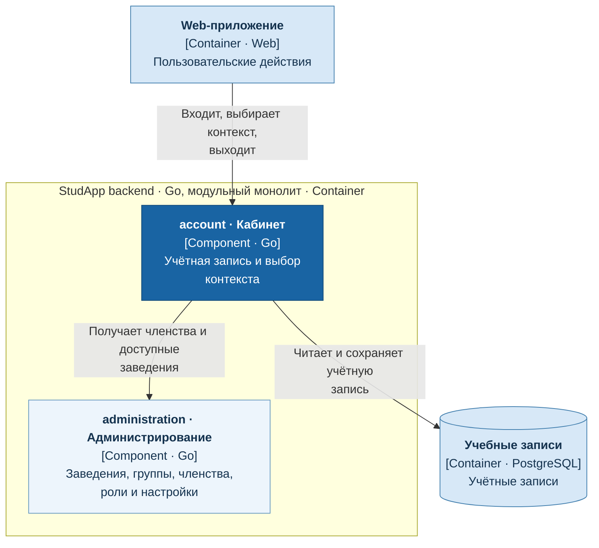

# Кабинет, вход и учебный контекст

Сервис `account` отвечает за учётную запись, вход, выход и выбор учебного заведения.

- Владеет данными учётной записи пользователя.
- Получает доступные заведения, членства и роли из `administration`.
- Смена заведения использует права выбранного контекста; роли между заведениями не переносятся.

## C4: диаграмма компонентов

