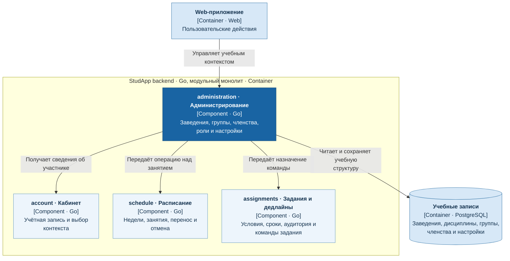

# Учебное администрирование

Сервис `administration` управляет заведениями, дисциплинами, группами, членствами, ролями и учебными настройками.

- Предоставляет остальным сервисам актуальные учебные связи и полномочия.
- Получает сведения о пользователе из `account`.
- Операции над занятиями передаёт `schedule`, назначение команд задания — `assignments`, сохраняя полномочия исполнителя.

## C4: диаграмма компонентов

