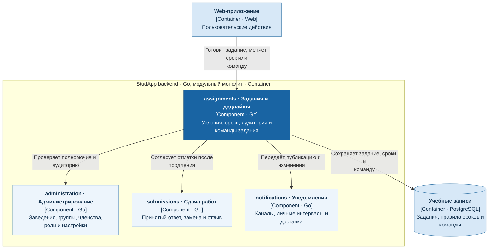

# Задания и дедлайны

Сервис `assignments` владеет заданиями, их аудиторией, публикацией, дедлайнами и составом команд. Команду задания назначает преподаватель.

- Черновик скрыт от студентов; отложенная публикация выполняется после заданного времени.
- Для успешно принятой файловой работы своевременность определяется началом загрузки.
- Отмена задания сохраняет принятые работы; общее продление снимает опоздание с работ, ставших своевременными, через `submissions`.

## C4: диаграмма компонентов

