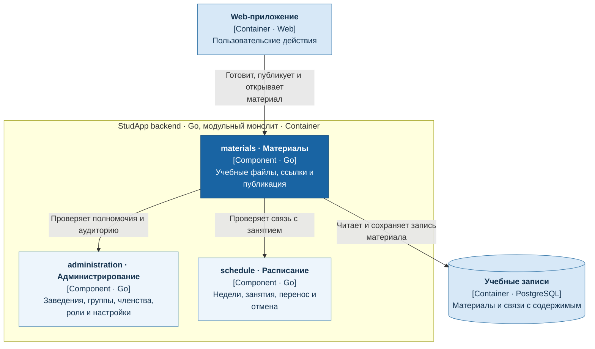

# Учебные материалы

Сервис `materials` отвечает за подготовку, публикацию и открытие учебных файлов и ссылок преподавателя или уполномоченного ассистента.

- Владеет записями материалов, связями с занятием, аудиторией и состоянием публикации.
- Студент получает опубликованные материалы своего учебного контекста.
- При распознанной недоступности материала возвращается пустое поле без ошибки.

## C4: диаграмма компонентов

