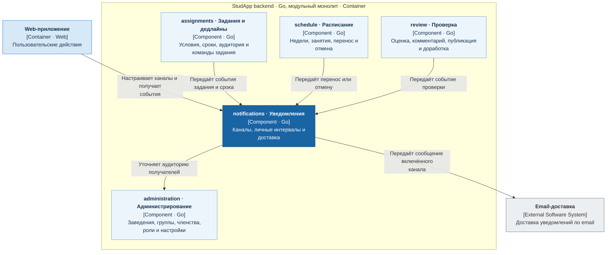

# Уведомления и напоминания

Сервис `notifications` отвечает за учебные уведомления внутри приложения и по email, настройки каналов и личные напоминания.

- Получает события от `assignments`, `schedule` и `review` после успешного учебного изменения.
- Владеет настройками доставки и личными интервалами; срок задания предоставляет `assignments`.
- Сбой email-доставки не отменяет принятую работу.

## C4: диаграмма компонентов

