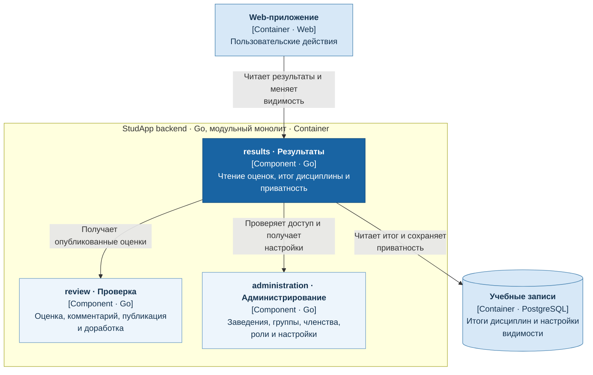

# Результаты и приватность

Сервис `results` предоставляет результаты работ и итог дисциплины, владеет итогом и настройками приватности.

- Оценки и комментарии читает из `review` без повторного расчёта.
- Итог дисциплины показывает отдельно; отсутствие итога не заменяется неутверждённой формулой.
- Приватность ограничивает чтение поверх базовых прав; собственные результаты доступны при сохранении учебного доступа.

## C4: диаграмма компонентов

