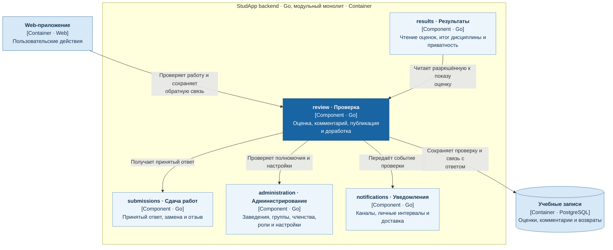

# Проверка и доработка

Сервис `review` отвечает за проверку принятого ответа, оценку, комментарий и возврат на доработку.

- Читает ответ из `submissions` и связывает результат проверки с конкретным ответом.
- Владеет оценкой, комментарием и доступностью результата для публикации; `results` получает разрешённую к показу обратную связь.
- Возврат на доработку содержит комментарий и срок; событие проверки передаётся в `notifications`.

## C4: диаграмма компонентов

