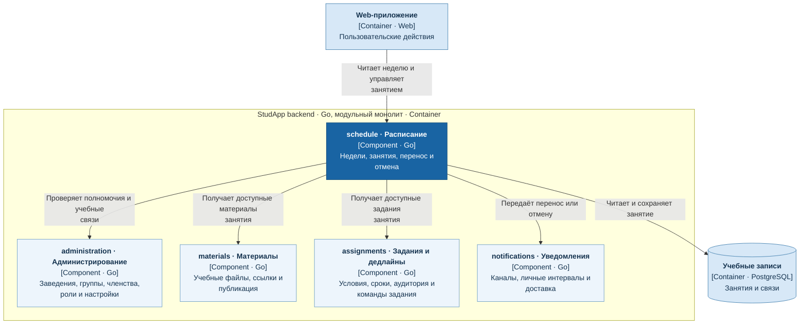

# Расписание и занятие

Сервис `schedule` отвечает за расписание недели, создание, перенос и отмену занятий.

- Владеет сведениями занятий; связанные материалы и задания получает из `materials` и `assignments`.
- Перенос и отмена занятия не изменяют автоматически сроки заданий и принятые работы.
- Передаёт сведения о переносах и отменах в `notifications`.

## C4: диаграмма компонентов

