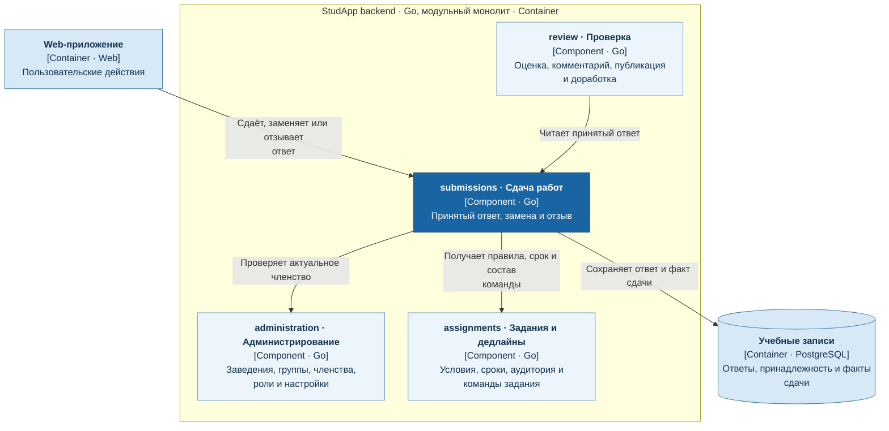

# Сдача работ

Сервис `submissions` отвечает за индивидуальную и командную сдачу, замену и отзыв ответа. Владеет текущей работой, связями с вложениями и фактом принятия.

- Явная сдача подтверждается после успешного сохранения; технический повтор не создаёт дубль.
- Неуспешная замена сохраняет прежний ответ.
- Правила приёма, сроки и состав команды получает из `assignments`; принятый ответ предоставляет `review`.

## C4: диаграмма компонентов

